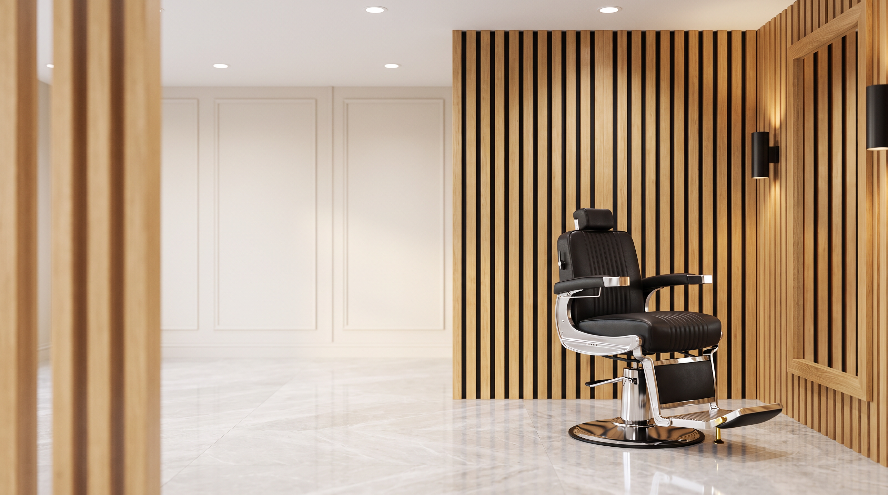
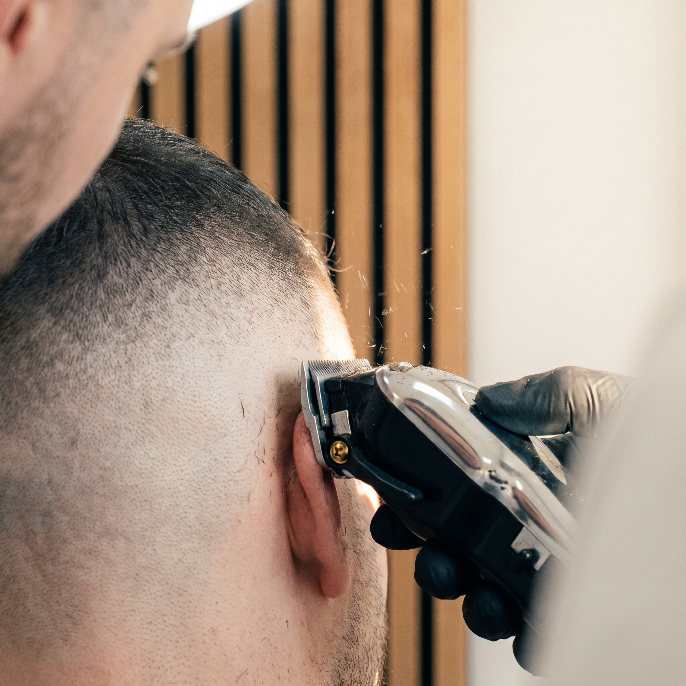
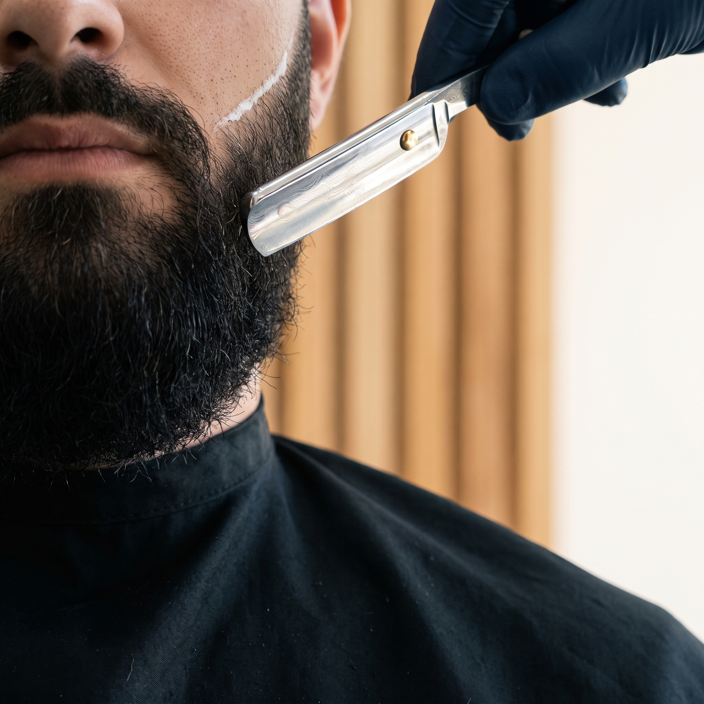
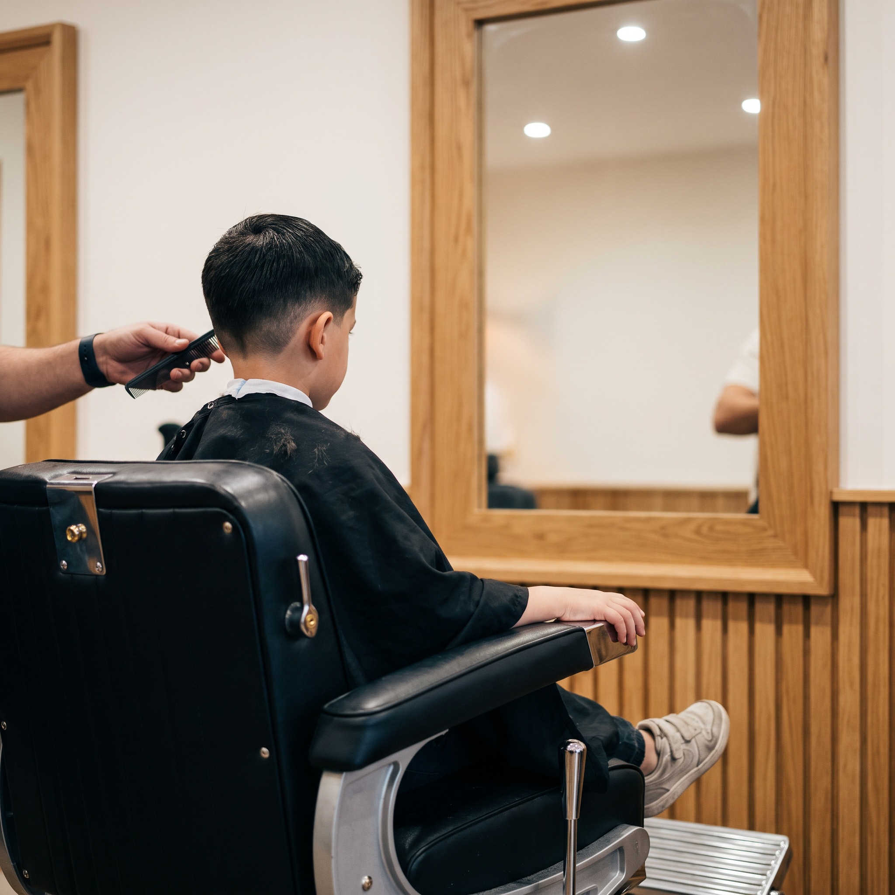
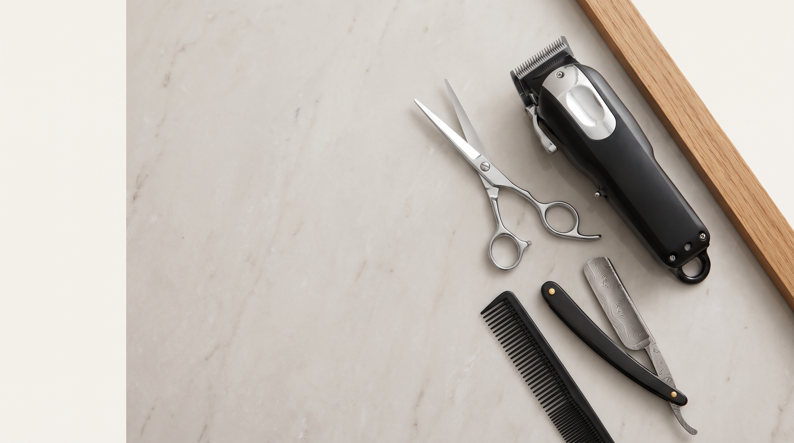

# Damas Barbershop: Embed-Guide

Es gibt noch kein Website-Projekt. Hier stehen deshalb fertige Snippets für jede Platzierung.
Alle Pfade sind relativ zu `damas-barbershop-assets/`. Die Tokens und Muster liegen in `damas-tokens.css`.
Die Dateinamen entsprechen der Spalte „Datei“ in `manifest.md`.

```html
<link rel="preconnect" href="https://fonts.googleapis.com">
<link href="https://fonts.googleapis.com/css2?family=Fraunces:opsz,wght@9..144,500;9..144,700&family=Manrope:wght@400;500;700&display=swap" rel="stylesheet">
<link rel="stylesheet" href="damas-tokens.css">
```

## 1 · Navigation + Logo / Favicon

Das Logo kommt später aus Claude Desktop. Bis dahin steht hier der Platzhalter `logo/damas-logo.svg`.

```html
<link rel="icon" href="logo/damas-favicon.svg" type="image/svg+xml">

<header class="nav">
  <a href="/" class="nav__brand"></a>
  <nav>
    <a href="#leistungen">Leistungen</a>
    <a href="#ueber-uns">Über uns</a>
    <a href="#besuch">Besuch</a>
  </nav>
</header>

<style>
.nav { position: fixed; inset: 0 0 auto; z-index: 10; display: flex; justify-content: space-between;
       align-items: center; padding: 16px clamp(16px, 4vw, 48px); color: var(--damas-salon); }
.nav a { color: inherit; text-decoration: none; margin-left: 24px; }
</style>
```

## 2 · Hero: Banner mit Ken Burns (Motion-Ersatz)

Das Banner hat rechts den Stuhl und links freie Fläche. Die Headline steht deshalb links.

```html
<section class="hero">
  <div class="hero__media">
    
    <!-- Falls später ein Video entsteht, ersetzt es das :
    <video class="hero__video" autoplay muted loop playsinline poster="banner/damas-banner.png">
      <source src="motion/damas-loop.mp4" type="video/mp4">
    </video> -->
  </div>
  <div class="hero__copy">
    <p class="hero__eyebrow">Barbershop · Worms</p>
    <h1>Komm rein.<br>Wie zu Hause.</h1>
    <p>Fades, Bart und Kinderhaarschnitte von Hussein &amp; Ali. Ohne Termin.</p>
    <a class="btn" href="#besuch">So findest du uns</a>
  </div>
</section>

<style>
.hero { position: relative; min-height: 100svh; display: grid; align-items: center; overflow: hidden; }
.hero__media, .hero__media img, .hero__media video { position: absolute; inset: 0; width: 100%; height: 100%; object-fit: cover; }
.hero__media::after { content: ""; position: absolute; inset: 0;
  background: linear-gradient(90deg, rgba(20,20,20,.78) 0%, rgba(20,20,20,.35) 45%, transparent 70%); }
.hero__copy { position: relative; max-width: 560px; padding: 0 clamp(16px, 6vw, 96px); color: var(--damas-salon); }
.hero h1 { font-family: var(--damas-font-display); font-size: clamp(2.6rem, 6vw, 5rem); line-height: 1.02; margin: .2em 0; }
.hero__eyebrow { color: var(--damas-gold); letter-spacing: .18em; text-transform: uppercase; font-size: .8rem; }
.btn { display: inline-block; margin-top: 1.5rem; padding: 14px 26px; background: var(--damas-gold);
       color: var(--damas-leather); text-decoration: none; font-weight: 700; border-radius: var(--damas-radius); }
@media (max-width: 700px) { .hero__media img { object-position: 70% center; } }
</style>
```

## 3 · Leistungen: Hero-Shots auf den Karten

```html
<section id="leistungen" class="services damas-slats-subtle">
  <h2>Leistungen</h2>
  <div class="services__grid">
    <article class="card">
      
      <h3>Haarschnitt &amp; Fade</h3><p>Sauber verblendet, genau so, wie du es willst.</p>
    </article>
    <article class="card">
      
      <h3>Bart</h3><p>Kontur mit dem Messer, Pflege, fertig.</p>
    </article>
    <article class="card">
      
      <h3>Kinder</h3><p>Geduld und ein Schnitt, auf den sie stolz sind.</p>
    </article>
  </div>
</section>

<style>
.services { padding: clamp(64px, 10vw, 128px) clamp(16px, 6vw, 96px); }
.services h2 { font-family: var(--damas-font-display); font-size: clamp(2rem, 4vw, 3rem); }
.services__grid { display: grid; gap: 24px; grid-template-columns: repeat(auto-fit, minmax(260px, 1fr)); }
.card { background: var(--damas-salon); border: 1px solid var(--damas-line); border-radius: var(--damas-radius); overflow: hidden; }
.card img { width: 100%; aspect-ratio: 1; object-fit: cover; display: block; }
.card h3, .card p { padding: 0 20px; } .card h3 { margin-top: 18px; }
.card:hover { border-color: var(--damas-chrome); }
</style>
```

## 4 · Über uns: Marmor-Textur + Detail-Shot

```html
<section id="ueber-uns" class="about damas-marble">
  <div class="about__text">
    <h2>Vater &amp; Sohn.</h2>
    <p>Hussein ist Friseurmeister, Ali steht seit Jahren an seiner Seite. Bei uns bist du nicht Kunde, sondern Familie.</p>
  </div>
  
</section>

<style>
.about { display: grid; gap: 40px; grid-template-columns: 1fr 1.4fr; align-items: center;
         padding: clamp(64px, 10vw, 128px) clamp(16px, 6vw, 96px); }
.about img { width: 100%; border-radius: var(--damas-radius); }
.about h2 { font-family: var(--damas-font-display); font-size: clamp(2rem, 4vw, 3rem); }
@media (max-width: 800px) { .about { grid-template-columns: 1fr; } }
</style>
```

## 5 · Besuch / Footer: „Nacht“-Sektion mit Lamellen-Streifen

```html
<div class="damas-slats" style="height: 12px"></div>
<footer id="besuch" class="damas-night footer">
  <h2>Komm vorbei.</h2>
  <hr class="damas-rule">
  <p>Wilhelm-Leuschner-Straße 1 · Ecke Lutherring · 67547 Worms</p>
  <p class="damas-accent">Ohne Termin · Di &amp; Mi −25 % für Schüler, Studenten, Rentner &amp; Beamte</p>
</footer>

<style>
.footer { padding: clamp(64px, 10vw, 112px) clamp(16px, 6vw, 96px); }
.footer h2 { font-family: var(--damas-font-display); font-size: clamp(2rem, 5vw, 3.5rem); margin: 0 0 24px; }
</style>
```
